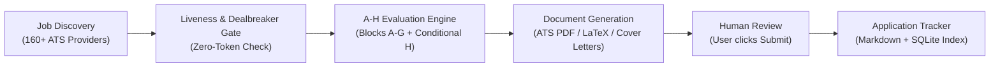

# Repository Analysis Report: `career-ops`

**Target Directory:** `C:\Users\rghos\OneDrive - Vivekananda Institute of Professional Studies\PROJECTS\Career Ops`  
**Repository Source:** [https://github.com/career-ops-hq/career-ops.git](https://github.com/career-ops-hq/career-ops.git)  
**Version:** `1.40.0` (Branch: `main`)  
**Analysis Date:** 2026-11-15  

---

## 1. Executive Summary & Purpose

**`career-ops`** is an open-source, local-first AI job search agent framework. It was created by **Santiago Fernández de Valderrama Aparicio (`@santifer`)** out of a personal job hunt (740 listings evaluated, 68 applied, 12 interviews, 1 offer as Head of Applied AI) and has expanded into an active open-source project with **800+ contributors**, **4,300+ commits**, and **1,260+ automated test suites**.

The project's mission is guided by the **CareerOps Manifesto**:
> *"Apply better to fewer. Signal over volume. Evidence over keywords. A human decides. Local-first. Dignity on both sides of the table."*

Unlike automated bot applications or bulk spam tools, `career-ops` provides an AI assistant that evaluates job descriptions against a candidate's actual qualifications, flags low-fit or expired roles, drafts tailored CVs and cover letters, prepares STAR+Reflection interview talking points, and logs all progress locally—while strictly requiring a human to review every detail and click Submit.



---

## 2. Core Architecture & Design Philosophy

The architecture of `career-ops` is built around three non-negotiable principles:

1. **Local-First & Data Sovereignty**: All evaluations, trackers, resumes, and reports reside on the user's local disk. No third-party servers, no telemetry, and no mandatory cloud accounts.
2. **AI-Agnostic Engine**: Prompts and evaluation logic live in Markdown modes (`modes/*.md`) adhering to the [Open Agent Skill standard](https://agentskills.io). It operates across multiple AI coding CLIs (Antigravity CLI `agy`, Claude Code, OpenAI Codex, OpenCode, Grok, Qwen, Kimi, Pi) or via headless scripts (Gemini API, Ollama, OpenAI-compatible endpoints).
3. **Strict Human-in-the-Loop (HITL)**: The tool never submits forms automatically, never sends emails, and actively advises users to skip low-fit listings (score below 4.0/5.0).

### The Two-Layer Data Contract (`DATA_CONTRACT.md`)

To allow frequent updates without clobbering personal data, the repository enforces a strict boundary between the **System Layer** and the **User Layer**:

| Layer | Directories & Files | Update Behavior |
| :--- | :--- | :--- |
| **System Layer** | `modes/*.md` (except user files), `*.mjs` scripts, `lib/`, `providers/`, `dashboard/`, `templates/`, `batch/` | Automatically updated via `node update-system.mjs`. Enforced in CI to prevent regression. |
| **User Layer** | `cv.md`, `config/profile.yml`, `modes/_profile.md`, `modes/_custom.md`, `modes/_brief.md`, `voice-dna.md`, `data/*`, `reports/*`, `output/*`, `jds/*` | **Strictly preserved.** The updater will never overwrite or modify these files. |

> [!NOTE]
> The dynamic data root can be relocated outside the repository using `CAREER_OPS_ROOT`, `CAREER_OPS_DATA_DIR`, or a `.career-ops-data` pointer file. This allows users to keep their personal job search data in a private git repo or encrypted drive while pulling upstream updates in the code repo.

### "Files are Canonical, Databases are Derived"
All application tracking (`data/applications.md`), candidate profiles, and evaluation reports are stored in plain, git-diffable Markdown, YAML, and TSV formats. SQLite is used purely as an ephemeral, read-accelerated index that can be dropped or rebuilt at any time.

### Flat Root Directory Convention
All standalone runnable scripts reside at the repository root (`scan.mjs`, `generate-pdf.mjs`, `doctor.mjs`, etc.). This deliberate flat structure ensures path stability for CLI plugins, external forks, automated scripts, and community extensions. All test suites are consolidated under `tests/**/*.test.mjs`.

---

## 3. Technology Stack & Key Dependencies

```
┌─────────────────────────────────────────────────────────────┐
│                       AI Agent Layer                        │
│   Antigravity CLI (agy) · Claude Code · Codex · OpenCode    │
│            Markdown Prompt Modes (modes/*.md)               │
├─────────────────────────────────────────────────────────────┤
│                     Runtime & Tooling                       │
│    Node.js (>=22.13.0) · Playwright (Chromium) · Undici     │
│       @google/generative-ai (Gemini) · js-yaml · dotenv     │
├─────────────────────────────────────────────────────────────┤
│                      User Interfaces                        │
│   • CLI / Chat (Primary Mode Driven by Agent Skills)        │
│   • Web Dashboard (Next.js 16.4.1, React 19, Tailwind v4)   │
│   • Terminal UI (Go 1.22+, Bubble Tea, Lipgloss)            │
└─────────────────────────────────────────────────────────────┘
```

- **Runtime**: Node.js (`^22.13.0 || >=23.4.0`) utilizing native ES Modules (`.mjs`). *(System local version: v22.23.3 - verified compatible)*.
- **Browser Automation & PDF Generation**: `playwright` (Chromium engine) rendering responsive HTML/CSS with Space Grotesk and DM Sans typography.
- **LLM SDKs**: `@google/generative-ai` for direct Gemini integration, plus integrations with Ollama and OpenAI-compatible inference APIs.
- **Web Interface (`web/`)**: Next.js 16.4.1, React 19.2.5, Tailwind CSS 4.2.2, Lucide React, and `@paper-design/shaders-react`.
- **Terminal UI (`dashboard/`)**: Built in Go using Charm's Bubble Tea, Lipgloss, and Catppuccin Mocha styling.
- **Testing**: 1,262 test suites using Node.js test runner and Playwright visual snapshot testing.

---

## 4. Key Subsystems & Workflows

### 4.1. Discovery Engine (`scan.mjs` & `providers/`)
The repository includes **160+ individual provider modules** under `providers/` that interface with public, no-auth job board APIs and ATS endpoints.
- **Supported ATS platforms**: Greenhouse, Ashby, Lever, Workday, BambooHR, SmartRecruiters, Teamtailor, Recruitee, Breezy, Taleo, iCIMS, SuccessFactors, Workable, Darwinbox, Keka, Zoho Recruit, and others.
- **Public & Regional Feeds**: HackerNews Who's Hiring, RemoteOK, Himalayas, Remotive, WeWorkRemotely, Tech in Asia, Glints, Prace.cz, and public sector portals.
- **Zero-Token Discovery**: Portals are scanned using direct HTTP calls (`undici`) without consuming LLM tokens. Postings are deduplicated against `data/scan-history.tsv` and filtered by positive/negative title keywords and location before queueing into `data/pipeline.md`.

### 4.2. Liveness & Dealbreaker Pre-Checks
Before spending evaluation time on a URL:
1. `check-liveness.mjs` checks whether the posting is still active, verifying HTTP status codes and inspecting page DOM for closure notices (e.g., "no longer accepting applications").
2. Domain and company blacklist (`data/blacklist.md`) is consulted.
3. Dealbreakers (such as hard salary floors or non-negotiable remote requirements from `config/profile.yml`) trigger a pre-evaluation stop.

### 4.3. The A–H Evaluation Engine (`modes/oferta.md`)
The core evaluation process assesses the role across multiple structured dimensions and generates a comprehensive report:

```
[Block A: Role Summary & Archetypes]
  ├── Archetype Identification (LLMOps, Agentic, PM, SA, FDE, Transformation)
  ├── Geo-Mismatch Check (remote metadata vs. in-office text in JD)
  ├── Work-Authorization & Visa Check (compares JD to candidate authorized regions)
  └── Culture & Team Signals

[Block B: CV Match & Requirement Analysis]
  ├── Two-Pass Generation: Pass 1 parses JD requirements; Pass 2 assesses CV match
  ├── 5 Importance Bands: critical (stated), high (structural), meaningful, preferred, low_signal
  └── Gap Analysis & Mitigation Tactics

[Block C: Level & Strategy]
  └── Positioning for seniority; defense against downleveling

[Block D: Compensation & Market Research]
  ├── Employer Category Classification (Big Tech, VC-backed, Early Startup, SMB, Agency)
  ├── Comp Reliability Tiering (Base vs. OTE, bonuses, equity)
  └── HR Verification Questions

[Block E: Customization Plan]
  └── Top 5 strategic CV modifications and LinkedIn alignment changes

[Block F: Interview Preparation]
  └── 6-10 STAR+R Stories (Situation, Task, Action, Result + Reflection)

[Block G: Posting Legitimacy & Ghost Job Detection]
  └── Posting age, active apply links, layoff history, repetitive reposting patterns

[Block H: Application Artifacts] (Generated if Score >= 4.0)
  └── Form answer drafts, personalized cover letter angles, recruiter outreach
```

### 4.4. Document Generation (ATS-Optimized Resumes & Cover Letters)
- Tailors CV content from `cv.md` based on matched keywords and bullet points.
- Compiles via Playwright into pixel-perfect, ATS-compliant single/two-page PDFs.
- LaTeX / Overleaf export supported via `generate-latex.mjs` and `cv-template.tex`.
- Cover letters auto-drafted across 4 strategic angles (Why this company, Problem solving, Approach, Tone).

### 4.5. Anti-Hallucination & Provenance Checking
A major feature of `career-ops` is strict anti-fabrication enforcement:
- **`verify-cv-facts.mjs`**: Halts PDF compilation if numbers, metrics, or factual statements in the tailored resume cannot be traced back to `cv.md` or `article-digest.md`.
- **`cv-title-check.mjs`**: Detects if job titles have been altered without explicit consent.
- **`story-provenance-check.mjs`**: Distinguishes verified achievements from unconfirmed assertions in the STAR story bank.

---

## 5. Security & Privacy Safeguards

The repository incorporates several rigorous defensive practices:
1. **SSRF Hardening**: Network calls in `providers/` are protected by `_ip-guard.mjs` and `_safe-url.mjs`, blocking requests to internal loopbacks, link-local addresses, and private subnets.
2. **Untrusted External Content Guard**: Job descriptions, emails, and scraped HTML are parsed strictly as passive data, preventing prompt-injection attacks from overriding system instructions.
3. **PII Interception**: `pii-interceptor.mjs` and `privacy-guard.mjs` sanitize sensitive personal identity elements before external requests are dispatched.
4. **No Direct POSTs**: No automated HTTP POST requests are implemented for external job boards; the application assistant prepares values locally for the candidate to review.

---

## 6. Directory Map of Key Files

```
Career Ops/
├── AGENTS.md                  # Unified system instructions for AI coding assistants
├── ARCHITECTURE.md            # System design and component map
├── DATA_CONTRACT.md           # Boundaries between user and system layers
├── package.json               # Node.js dependencies and lifecycle scripts
├── scan.mjs                   # Main entry point for zero-token ATS portal scanning
├── generate-pdf.mjs           # Playwright-powered ATS CV PDF generation
├── doctor.mjs                 # Diagnostic utility checking prerequisites and configuration
├── verify-pipeline.mjs        # Health and integrity verifier for tracker and reports
├── modes/                     # Markdown skill modes (oferta, pdf, cover, scan, pipeline)
│   ├── _shared.md             # Shared scoring criteria, archetypes, and rules
│   ├── oferta.md              # Detailed A-H job evaluation specification
│   └── ...                    # Language-specific and specialized sub-modes
├── providers/                 # 160+ scraper modules for distinct ATS and job boards
├── lib/                       # Core engine utilities (SSRF guards, markdown, liveness)
├── templates/                 # HTML/CSS and LaTeX CV templates
├── plugins/                   # Optional integrations (Gmail, Notion, Apify, H1B sponsor)
├── dashboard/                 # Standalone Go TUI pipeline viewer (Bubble Tea)
├── web/                       # Standalone Next.js 16 Web UI
└── tests/                     # 1,260+ automated test suites covering all subsystems
```

---

## 7. Recommended Next Steps for Local Usage

To start using `career-ops` in this directory:

### Step 1: Install Node Dependencies
Open a terminal in `Career Ops` and execute:
```powershell
npm install
```
*(If you plan to generate PDF resumes, install the Playwright Chromium browser binary)*:
```powershell
npx playwright install chromium
```

### Step 2: Run System Diagnostics
Verify your environment and check which user-layer files need initialization:
```powershell
node doctor.mjs --json
```

### Step 3: Initialize Your Profile
To initialize default templates for your CV and profile:
```powershell
node doctor.mjs --json --init-templates
```
This generates:
- `cv.md`: Paste your master resume or CV here in markdown.
- `config/profile.yml`: Specify your target job titles, salary expectations, and location settings.
- `portals.yml`: Configure company career boards to scan (copy from `templates/portals.example.yml`).
- `modes/_profile.md`: Fine-tune your career archetypes, positioning narrative, and negotiation anchors.

### Step 4: Evaluate a Job
Once configured, you can evaluate any live job posting URL directly using your preferred CLI agent (or standalone scripts like `node gemini-eval.mjs <url>`).
